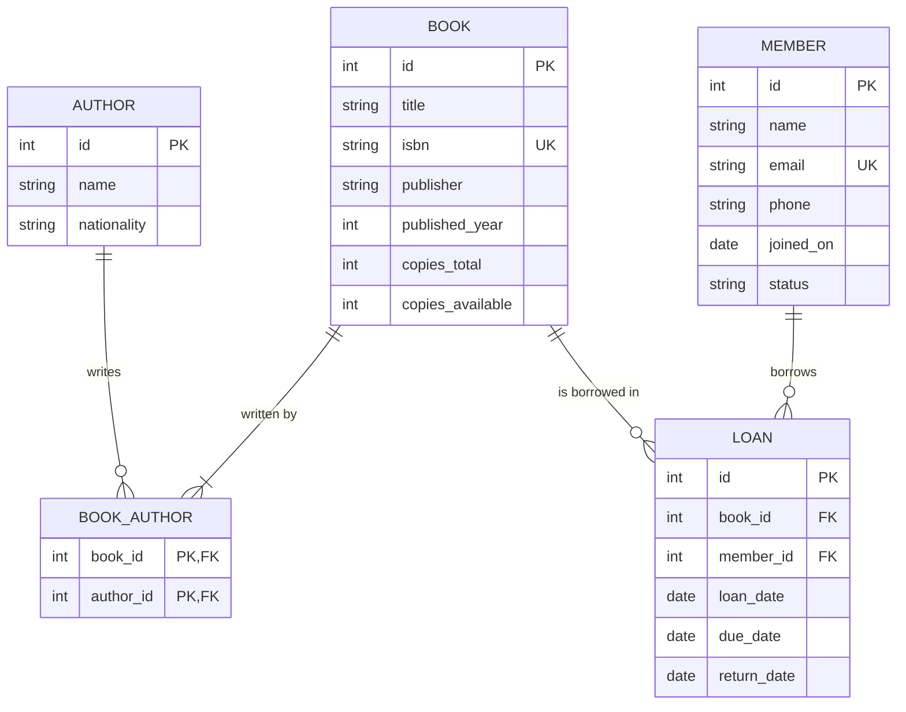

# ER Diagram: Library Management System

Open this file with the Markdown preview in VS Code (install the "Markdown Preview Mermaid Support" extension if the diagram does not render), or push it to GitHub where it renders automatically. For the lab record you can also export it as an image from https://mermaid.live.

## Cardinality summary
- One Book has one or more Authors, and one Author writes many Books (M:N via `BOOK_AUTHOR`).
- One Member has many Loans, and one Book appears in many Loans (so Member and Book are M:N via `LOAN`).
