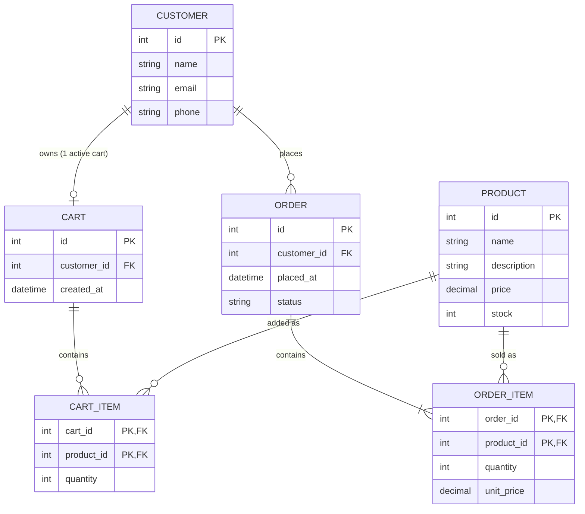

# Conceptual Data Model: E-Commerce System

Entities: **Customer, Product, Order, Cart** (plus the helper entities `CartItem` and `OrderItem` that resolve the many-to-many relationships).

## Business requirements turned into the model
| Requirement | Modelling decision |
|---|---|
| A customer can place many orders | Customer 1:M Order |
| A customer has one active cart | Customer 1:1 Cart |
| A cart holds many products, a product sits in many carts | Cart M:N Product through `CART_ITEM` |
| An order holds many products | Order M:N Product through `ORDER_ITEM` |
| Prices change over time | `ORDER_ITEM.unit_price` copies the price at the time of purchase |
| Email must be unique, price >= 0, quantity > 0 | constraints on the logical model |

## Three levels (from the lecture)
- **Conceptual:** this diagram (entities and relationships only).
- **Logical:** attributes, data types, keys, constraints (the entity boxes above).
- **Physical:** the actual tables. See `sqlalchemy-app/models.py` for the Student Management System physical model.
