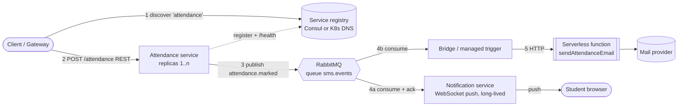

# SMS target architecture (PBL: Integrate, Classify, Migrate, Review)

## 1. Target architecture

Notes: 4a and 4b each need their **own queue** bound to the event (a work queue gives each message to one consumer only); in RabbitMQ use a fanout/topic exchange. The producer does not know how many consumers exist. In this repository the two consumers are demonstrated on two queues (`sms.events`, `sms.email`).

## 2. Discovery choice: client-side or server-side?
| | Client-side (Consul + our `consul-client.js`) | Server-side (Kubernetes Service / API gateway) |
|---|---|---|
| Who balances load | each client (we use round-robin) | the router |
| Hops | fewer | one extra |
| Client complexity | every client needs discovery code | none |
| Failure point | registry must be reachable (clients can cache) | router is critical |

For the college deployment on Kubernetes, **server-side via DNS (`attendance.default.svc.cluster.local`)** is the natural choice: no discovery code in services. Consul fits a mixed VM/container estate. The code here shows client-side discovery because that is what the lab teaches.

## 3. Classify each SMS interaction (PBL task 2)
Criteria from lecture §3.1: does the caller need the answer **now** to continue? is it a fact that **already happened** that zero-or-many others may react to?

| Interaction | Choice | Justification |
|---|---|---|
| Get student profile (Student service) | **Sync REST** | the caller cannot render without the data; it is a query |
| Check if a class exists before marking attendance | **Sync REST** | the request must be validated now |
| Attendance marked, notify guardians | **Async event** `attendance.marked` | side effect; Attendance must not wait or fail if Notification is down |
| Result published | **Async event** `result.published` | many consumers (push, e-mail, analytics); bursty on results day |
| Fee deadline reminders | **Async / scheduled** | time-triggered job, no caller waiting |
| Login / token validation | **Sync** | the request is blocked until it is known |
| Audit trail of attendance | **Async consumer** of the same event | added with no change to the producer |
| Report export requested by a teacher | **Async job** plus a status query | slow work; return 202 and let the client poll or receive an event |

Every synchronous call needs a timeout, bounded retries with backoff and (at scale) a circuit breaker, so a slow callee cannot exhaust the caller.

## 4. Migrate one workload to serverless (PBL task 3)
**Chosen:** e-mail dispatch on `attendance.marked` (`serverless/index.js`).

| Why it fits FaaS | What would break with long-lived state |
|---|---|
| bursty (results day, fee deadlines), idle most of the year, so pay-per-invocation is cheap | a DB connection pool or in-memory "already sent" set would be lost whenever an instance is recycled, and parallel instances would not share it |
| stateless: everything comes from the event | dedup must live in a database (the bridge keeps the idempotency store) |
| asynchronous: a cold start of a few hundred ms does not matter | |
| short: one HTTP call to a mail provider | |

**Not migrated:** the Notification push service. It holds WebSocket connections open for hours, which a function cannot do, so it stays a container.

## 5. Delivery semantics and failure handling
- **At-least-once** delivery; the consumer is idempotent by `eventId` (stored after success).
- **Handler failure:** nack with requeue; unprocessable messages are rejected without requeue (add a dead-letter queue in production).
- **Broker down:** Attendance returns 503 (tested); it does not silently drop the event.
- **Open gap (dual write):** if the database write succeeds and the publish fails, the event is lost. The standard fix is the **outbox pattern**. Not implemented here.
- **Ordering:** per queue only; do not rely on global ordering.

## 6. Review questions peers may ask (with short answers)
| Question | Answer |
|---|---|
| Why not Kafka? | Task distribution with acks fits RabbitMQ. Kafka is better if you need replay of history, partitioned streams and audit. |
| Why not just REST between Attendance and Notification? | Temporal coupling: if Notification is down, marking attendance would fail or need retries inside Attendance. |
| What if two Notification replicas run? | A shared queue gives each message to one replica (competing consumers). The idempotency store must then be shared (database), not in memory. |
| Is exactly-once possible? | Only inside some systems. End to end you design for at-least-once plus idempotency. |
| Where is the single point of failure? | The registry and the broker; run them clustered. Clients can cache discovery results. |
| Cost surprise with FaaS? | Constant high traffic can be cheaper on containers. Pay-per-invocation rewards bursts. |
